<div align="center">


<br>

[](https://www.gnu.org/software/bash/)
[](https://www.gnu.org/software/wget/)
[](https://www.kernel.org/)

**Mirror a website locally. Explore it offline.**

[Quick start](#-quick-start) · [Features](#-features) · [Usage](#-usage)

</div>


## ◈ What is ar0xmirror?

`ar0xmirror` is a Bash terminal interface for mirroring websites with GNU Wget. It wraps Wget's mirroring options in a guided workflow, so you can enter a site, adjust crawl settings, watch progress, and review the resulting files.

The interface helps configure the crawl; **Wget performs the actual downloading**. Results depend on the target website, its access rules, and the resources Wget can reach.

## ✦ Features

- **Guided workflow** — enter a website and review crawl settings before starting.
- **Live progress** — view progress information such as file count, downloaded size, elapsed time, transfer rate, and the latest saved path.
- **Configurable crawling** — adjust the destination folder, request wait, rate limit, user agent, and extra Wget flags.
- **Command-line launch** — open the interactive interface or start with a prefilled site.
- **Automatic mode** — use `-y` / `--yes` to run with the tool's default settings without interactive menus.
- **Completion report** — review the resulting download size and file count.
- **Interrupt support** — press `Ctrl+C` to stop an active run while keeping the partial mirror.
- **Terminal compatibility** — includes an ASCII fallback for terminals that cannot display the preferred characters and respects `NO_COLOR`.


## ⚡ Quick start

### Requirements

- Linux or another compatible Unix-like environment
- Bash 4 or newer
- GNU Wget
- A terminal

### Download and run

```bash
curl -fsSL https://raw.githubusercontent.com/ar0x1/ar0xmirror/main/ar0xmirror.txt -o ar0xmirror
chmod +x ar0xmirror
./ar0xmirror
```

If `curl` is unavailable, use `wget`:

```bash
wget -O ar0xmirror https://raw.githubusercontent.com/ar0x1/ar0xmirror/main/ar0xmirror.txt
chmod +x ar0xmirror
./ar0xmirror
```

### Clone the repository

```bash
git clone https://github.com/ar0x1/ar0xmirror.git
cd ar0xmirror
cp ar0xmirror.txt ar0xmirror
chmod +x ar0xmirror
./ar0xmirror
```


## ⌘ Usage

### Interactive mode

```bash
./ar0xmirror
```

### Start with a site prefilled

```bash
./ar0xmirror example.com
```

### Automatic mode

```bash
./ar0xmirror example.com --yes
```

Short form:

```bash
./ar0xmirror example.com -y
```

### Help and version

```bash
./ar0xmirror --help
./ar0xmirror --version
```




## ⚙ How it works

The script builds a Wget command using mirroring options. The core command pattern is:

```bash
wget -mkEpnp -P ~/Downloads https://example.com
```

| Option | Purpose |
| --- | --- |
| `-m` | Mirror mode with recursive retrieval. |
| `-k` | Convert links so downloaded pages can link to local copies. |
| `-E` | Adjust extensions for files served with a content type that implies an extension. |
| `-p` | Download page requisites such as images and stylesheets. |
| `-np` | Do not ascend above the starting URL. |
| `-P` | Choose the local directory for downloaded content. |

The default destination is `~/Downloads`. Dynamic applications, login-protected pages, API-driven content, and resources blocked by a server may not work as offline copies.

## 🛠 Troubleshooting

**`wget: command not found`**

Install GNU Wget with your operating system's package manager.

Debian / Ubuntu:

```bash
sudo apt update
sudo apt install wget
```

**`Permission denied`**

```bash
chmod +x ar0xmirror
```

**The mirror is incomplete**

Some sites rely on JavaScript, login sessions, APIs, anti-bot protections, or resources on other domains. Wget cannot guarantee a fully functional offline copy of every website.

## 🔐 Responsible use

Mirror only websites you are authorised to archive. Respect website terms, copyright, robots policies, access controls, and applicable laws. Use sensible wait intervals or rate limits to avoid overloading servers.

## ◈ Author

Created by **ar0x** · [GitHub profile](https://github.com/ar0x1) · [Repository](https://github.com/ar0x1/ar0xmirror)

<div align="center">


<sub>Built with Bash and GNU Wget.</sub>

</div>
